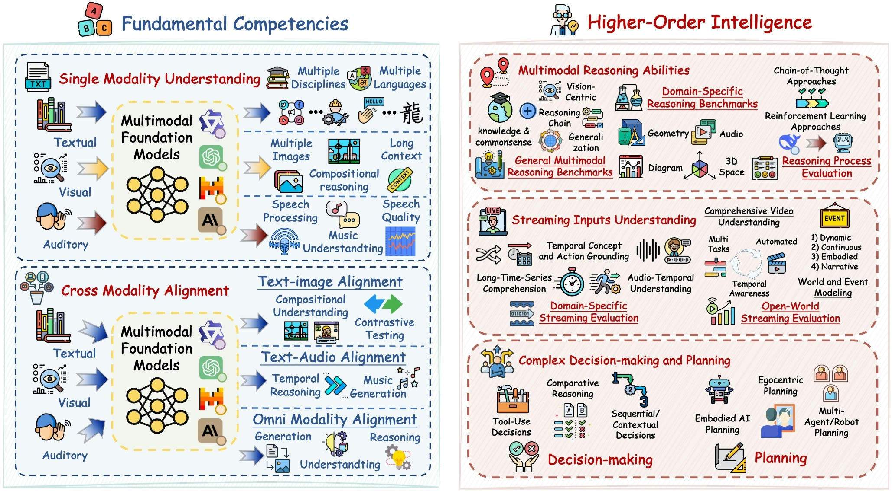

# 🔬 Awesome Multimodal Foundation Model Evaluations

  

## 🌟 Overview

This repository tracks research papers on **Multimodal Foundation Model Evaluations** and serves as the companion paper list for the survey **"A Comprehensive Survey of Multimodal Foundation Model Evaluation: A Hierarchical Perspective and Extensive Applications."**

The survey uses a three-layer hierarchy as an analytical pathway rather than a universal difficulty ranking. **Fundamental competencies** and **higher-order intelligence** group capability evidence, while **real-world applications** frame how those capabilities are tested under cross-cutting deployment requirements and domain-specific constraints. Its information-fusion perspective connects each layer to observable evidence use, shortcut risks, and the validation still needed for deployment. The survey presents a documented search-and-selection flow, category and signal counts, a worked fusion-gain example, and a comparison of benchmark designs.

The maintained collection draws on academic indexes, venue proceedings, arXiv, DBLP, Google Scholar, ACL Anthology, OpenReview, CVF, ACM, and IEEE Xplore, supplemented by citation tracing from surveys and benchmark papers. The manuscript distinguishes core evaluation works from unimodal comparators and contextual sources. The search catalogue and the detailed synthesis have distinct membership and counting units, documented in the accompanying data.

## 📑 Table of Contents

- [🌟 Overview](#-overview)
- [🧭 Survey Snapshot](#-survey-snapshot)
- [🔍 Key Categories](#-key-categories)
- [📚 Paper List](#-paper-list)
  - [🎯 Fundamental Competencies](#-fundamental-competencies)
  - [🧠 Higher-Order Intelligence](#-higher-order-intelligence)
  - [🌍 Real-World Applications](#-real-world-applications)
- [🚧 Emerging Directions](#-emerging-directions)
- [🤝 Contributing](#-contributing)

## 🧭 Survey Snapshot

### Reference Inventory and Coverage

The documented search identified 3,634 records (3,250 arXiv query records and 384 maintained-bibliography records). Consolidating 339 duplicates yielded 3,295 studies for screening: 2,289 evaluation-catalogue records, 83 supporting references, and 923 exclusions. The detailed synthesis uses 175 representative evaluation resources; the other 2,114 eligible records remain in the catalogue. The paper cites 258 works in total, including 14 unimodal comparators and 69 contextual sources.

The indexed queries cover initial arXiv submission dates from 1 January 2018 through 31 July 2026; abstracts and publication metadata reflect the records available at retrieval on 30 October 2026. Exact queries, source links, duplicate relationships, screening reasons, and synthesis membership are supplied with the paper.

The category and signal figures use the 175-resource synthesis set and allow multiple labels. All core records have source-supported signal codes. Structured and time-series evidence is represented separately, including clinical tables and vital-sign sequences. DESPITE is a text/symbolic planning comparator, rather than a sensory multimodal resource. Counts describe the selected collection rather than field-wide prevalence or benchmark quality.

### What Representative Benchmarks Establish

The comparison below concerns evaluation evidence. Scores obtained with different tasks, resolutions, temporal access rules, or clinical settings do not share a common reliability scale.

| Benchmark | Evidence targeted | Diagnostic distinction | Remaining reliability question |
|---|---|---|---|
| [MMMU-Pro](https://aclanthology.org/2025.acl-long.736/) | Multidisciplinary visual understanding | Filters text-only shortcuts and varies question presentation | Does success persist under new domains and input corruption? |
| [MME-RealWorld](https://openreview.net/forum?id=k5VHHgsRbi) | High-resolution visual tasks | Tests fine details in application-relevant scenes | Does the result transfer to an operational workflow and its error costs? |
| [MMEvalPro](https://aclanthology.org/2025.naacl-long.247/) | Calibrated multimodal evaluation | Checks perception prerequisites separately from reasoning | Does a correct answer follow from the intended evidence? |
| [DAVE](https://doi.org/10.52202/085713-1786) | Audio–visual evidence use | Matched sensory-channel ablations reveal positive or negative gain | Which items require both channels, and with what uncertainty? |
| [MathVerse](https://doi.org/10.1007/978-3-031-73242-3_10) | Visual mathematical reasoning | Varies textual and diagram information | Does visual dependence hold beyond the tested variants? |
| [LongVideoBench](https://arxiv.org/abs/2407.15754) | Long-context video understanding | Tests evidence distributed across a supplied sequence | Can the model respond before future frames arrive? |
| [OVO-Bench](https://arxiv.org/abs/2501.05510) | Online video understanding | Restricts evidence to the temporal setting under evaluation | Are response delay and memory demands acceptable in use? |
| [AgentClinic](https://doi.org/10.1038/s41746-026-02674-7) | Tool-using clinical interaction | Tests evidence acquisition in simulated encounters | Do clinicians and patients benefit in prospective practice? |
| [OmniMedVQA](https://arxiv.org/abs/2402.09181) | Medical visual question answering | Covers diverse medical-image questions | Are decisions calibrated across hospitals and patient groups? |
| [MM-SafetyBench](https://doi.org/10.1007/978-3-031-72992-8_22) | Multimodal safety under attack | Exposes failures that benign accuracy misses | Does refusal preserve useful behavior on benign requests? |

### Worked Fusion-Gain Example

The following values come from **Table 9 of the published DAVE paper**, not new model runs or a current leaderboard. Let A, V, and T denote audio, video, and the common question-and-option text. Define `G = S(A,V,T) − max[S(V,T), S(A,T)]` using accuracy on the same task and model. A single sensory-channel baseline still includes T.

| Model | A+V+T (%) | V+T (%) | A+T (%) | Fusion gain (percentage points) |
|---|---:|---:|---:|---:|
| Gemini 2.0 Flash | 50.85 | 37.14 | 23.50 | +13.71 |
| Gemini 1.5 Flash | 49.51 | 28.60 | 18.04 | +20.91 |
| video-SALMONN | 17.13 | 21.47 | 15.17 | −4.34 |
| Video-LLaMA-2 | 31.27 | 33.79 | 7.28 | −2.52 |

Source: [DAVE, NeurIPS 2025, DOI 10.52202/085713-1786](https://doi.org/10.52202/085713-1786), [published PDF, Table 9, p. 30](https://proceedings.nips.cc/paper_files/paper/2025/file/4d5f03fdb238255019826032ae7cc8e2-Paper-Datasets_and_Benchmarks_Track.pdf). Gains are arithmetic differences between reported means. Paired uncertainty estimates cannot be recovered from the published aggregate values alone. Positive gain indicates an advantage from the additional sensory input under that setting; it does not identify the model's internal fusion architecture or establish deployment readiness. Negative gain can indicate interference and calls for further diagnosis.

### Case Study

The current manuscript includes a Qwen-2.5-Omni case study to show how one omni-modal model report can be mapped into the hierarchy: text, vision, audio, and speech-generation evaluations map to fundamental competencies, while cross-modal reasoning and temporal-video tests map to higher-order intelligence. Streaming response generation is an output- and system-side capability, not by itself evidence of online streaming-input understanding. The report contains no application-specific validation; robustness, latency, safety, and expert or domain validation remain evidence required for deployment.

## 🔍 Key Categories

| Layer / analytical role | Category | Description |
|---|---|---|
| **🎯 Fundamental Competencies** | Single-modality understanding and cross-modality alignment | Core perception, comprehension, and semantic alignment across text, image, audio, video, and other modalities |
| **🧠 Higher-Order Intelligence** | Reasoning, temporal or streaming-input understanding, decision-making, and planning | Evaluation settings centered on joint inference, sequential context, tool use, state maintenance, decisions, and plans; the grouping is organizational rather than a universal claim of greater difficulty |
| **🌍 Real-World Applications** | Cross-cutting value alignment and domain-specific medical, biological, industrial, and societal evaluation | Deployment-oriented requirements and settings; placement here does not establish deployment readiness or intrinsic task difficulty |

### Subcategories

- **📷 Single Modality Understanding**: textual, visual, auditory, and other modality-specific comprehension.
- **🔗 Cross-Modality Alignment**: semantic consistency and temporal alignment across modalities.
- **💡 Multimodal Reasoning**: logical, mathematical, spatial, causal, and process-level reasoning.
- **🎬 Streaming Inputs Understanding**: an umbrella for temporally ordered inputs that distinguishes offline long-context or temporal comprehension from genuinely online streams revealed incrementally under timestamp-aware or latency-constrained response conditions.
- **📋 Complex Decision-Making and Planning**: tool-use, embodied planning, egocentric planning, and multi-agent coordination.
- **⚖️ Value Alignment**: a cross-cutting dimension covering instruction following, human-preference alignment, safety-oriented behavior, and culturally or contextually appropriate responses; factuality and robustness are related reliability dimensions, not synonyms for alignment.
- **🏥 Medical Applications**: clinical expertise, multi-specialty generalization, fairness, hallucination, and patient-centered reliability.
- **🧬 Biological Applications**: multi-omics, protein, RNA, DNA, and drug-response evaluation.
- **🏭 Other Applications**: robotics, anomaly detection, engineering documents, transportation, agriculture, accessibility, and social-good evaluation.

## 📚 Paper List

### 🎯 Fundamental Competencies

#### 📷 Single Modality Understanding

- **[MME-RealWorld: Could Your Multimodal LLM Challenge High-Resolution Real-World Scenarios that are Difficult for Humans?](https://openreview.net/forum?id=k5VHHgsRbi)** (*2025*) `ICLR`
- **[Measuring Massive Multitask Language Understanding](https://arxiv.org/abs/2009.03300)** (*2021*) `ICLR`
- **[MMLU-Pro: A More Robust and Challenging Multi-Task Language Understanding Benchmark](https://arxiv.org/abs/2406.01574)** (*2024*) `NeurIPS`
- **[CMMLU: Measuring Massive Multitask Language Understanding in Chinese](https://aclanthology.org/2024.findings-acl.671/)** (*2024*) `ACL Findings`
- **[KMMLU: Measuring Massive Multitask Language Understanding in Korean](https://aclanthology.org/2025.naacl-long.206/)** (*2025*) `NAACL`
- **[Global MMLU: Understanding and Addressing Cultural and Linguistic Biases in Multilingual Evaluation](https://aclanthology.org/2025.acl-long.919/)** (*2025*) `ACL`
- **[MMLU-ProX: A Multilingual Benchmark for Advanced Large Language Model Evaluation](https://aclanthology.org/2025.emnlp-main.79/)** (*2025*) `EMNLP`
- **[MDK12-Bench: A Comprehensive Evaluation of Multimodal Large Language Models on Multidisciplinary Exams](https://arxiv.org/abs/2508.06851)** (*2025*) `arXiv`
- **[Microsoft COCO: Common Objects in Context](https://arxiv.org/abs/1405.0312)** (*2014*) `ECCV`
- **[Flickr30k Entities: Collecting Region-to-Phrase Correspondences for Richer Image-to-Sentence Models](https://openaccess.thecvf.com/content_iccv_2015/html/Plummer_Flickr30k_Entities_Collecting_ICCV_2015_paper.html)** (*2015*) `ICCV`
- **[LLaVA-Grounding: Grounded Visual Chat with Large Multimodal Models](https://arxiv.org/abs/2312.02949)** (*2024*) `ECCV`
- **[MMIU: Multimodal Multi-Image Understanding for Evaluating Large Vision-Language Models](https://arxiv.org/abs/2408.02718)** (*2025*) `ICLR`
- **[MileBench: Benchmarking MLLMs in Long Context](https://arxiv.org/abs/2404.18532)** (*2024*) `COLM`
- **[MLLM-CompBench: A Comparative Reasoning Benchmark for Multimodal LLMs](https://arxiv.org/abs/2407.16837)** (*2024*) `NeurIPS`
- **[Evaluating MLLMs with Multimodal Multi-Image Reasoning Benchmark (MMRB)](https://arxiv.org/abs/2506.04280)** (*2025*) `arXiv`
- **[LENS: Multi-Level Evaluation of Multimodal Reasoning with Large Language Models](https://arxiv.org/abs/2505.15616)** (*2025*) `arXiv`
- **[MMR-Bench: A Comprehensive Benchmark for Multimodal LLM Routing](https://doi.org/10.1007/978-3-032-37083-9_34)** (*2026*) `ECCV`
- **[WorldBench: A Challenging and Visually Diverse Multimodal Reasoning Benchmark](https://arxiv.org/abs/2606.06538)** (*2026*) `arXiv`
- **[Seeing Is Believing? A Benchmark for Multimodal Large Language Models on Visual Illusions and Anomalies (VIA-Bench)](https://arxiv.org/abs/2602.01816)** (*2026*) `arXiv`
- **[VRB: Evaluating Multimodal LLMs on Classroom-Authentic Visual Problems from Primary Education](https://arxiv.org/abs/2602.12196)** (*2026*) `arXiv`
- **[Dynamic-SUPERB: Towards a Dynamic, Collaborative, and Comprehensive Instruction-Tuning Benchmark for Speech](https://arxiv.org/abs/2309.09510)** (*2024*) `ICASSP`
- **[MuChoMusic: Evaluating Music Understanding in Multimodal Audio-Language Models](https://arxiv.org/abs/2408.01337)** (*2024*) `ISMIR`
- **[Enabling Auditory Large Language Models for Automatic Speech Quality Evaluation](https://arxiv.org/abs/2409.16644)** (*2025*) `ICASSP`
- **[AudioBench: A Universal Benchmark for Audio Large Language Models](https://aclanthology.org/2025.naacl-long.218/)** (*2025*) `NAACL`
- **[Evaluating Multimodal Large Language Models on Core Music Perception Tasks](https://arxiv.org/abs/2510.22455)** (*2025*) `arXiv`
- **[ART: A Benchmark for Audio Reasoning Capabilities of Multimodal Large Language Models](https://aclanthology.org/2026.eacl-long.42/)** (*2026*) `EACL`

#### 🔗 Cross-Modality Alignment

- **[Synthesize, Diagnose, and Optimize: Towards Fine-Grained Vision-Language Understanding](https://openaccess.thecvf.com/content/CVPR2024/papers/Peng_Synthesize_Diagnose_and_Optimize_Towards_Fine-Grained_Vision-Language_Understanding_CVPR_2024_paper.pdf)** (*2024*) `CVPR`
- **[VALSE: A Task-Independent Benchmark for Vision and Language Models Centered on Linguistic Phenomena](https://aclanthology.org/2022.acl-long.567/)** (*2022*) `ACL`
- **[AudioTime: A Temporally-Aligned Audio-Text Benchmark Dataset](https://arxiv.org/abs/2407.02857)** (*2025*) `ICASSP`
- **[Simple and Controllable Music Generation](https://arxiv.org/abs/2306.05284)** (*2023*) `NeurIPS`
- **[VBench: Comprehensive Benchmark Suite for Video Generative Models](https://openaccess.thecvf.com/content/CVPR2024/papers/Huang_VBench_Comprehensive_Benchmark_Suite_for_Video_Generative_Models_CVPR_2024_paper.pdf)** (*2024*) `CVPR`
- **[Animal-Bench: Benchmarking Multimodal Video Models for Animal-Centric Video Understanding](https://proceedings.neurips.cc/paper_files/paper/2024/hash/8fa604a81e5a236e2f38e917109571a3-Abstract-Conference.html)** (*2024*) `NeurIPS`
- **[ChronoMagic-Bench: A Benchmark for Metamorphic Evaluation of Text-to-Time-Lapse Video Generation](https://arxiv.org/abs/2406.18522)** (*2024*) `NeurIPS`
- **[MME-Unify: A Comprehensive Benchmark for Unified Multimodal Understanding and Generation Models](https://openreview.net/forum?id=7x6TxVIarj)** (*2026*) `ICLR`
- **[Multimodal RewardBench 2: Evaluating Omni Reward Models for Interleaved Text and Image](https://arxiv.org/abs/2512.16899)** (*2025*) `arXiv`
- **[See, Hear, and Understand: Benchmarking Audiovisual Human Speech Understanding in Multimodal Large Language Models (AV-SpeakerBench)](https://arxiv.org/abs/2512.02231)** (*2025*) `arXiv`
- **[AVI-Bench: Toward Human-Like Audio-Visual Intelligence of Omni-MLLMs](https://arxiv.org/abs/2606.07643)** (*2026*) `arXiv`
- **[FutureOmni: Evaluating Future Forecasting from Omni-Modal Context for Multimodal LLMs](https://arxiv.org/abs/2601.13836)** (*2026*) `arXiv`

### 🧠 Higher-Order Intelligence

#### 💡 Multimodal Reasoning

- **[MMMU-Pro: A More Robust Multi-discipline Multimodal Understanding Benchmark](https://aclanthology.org/2025.acl-long.736/)** (*2025*) `ACL`
- **[CLEVR: A Diagnostic Dataset for Compositional Language and Elementary Visual Reasoning](https://arxiv.org/abs/1612.06890)** (*2017*) `CVPR`
- **[A-OKVQA: A Benchmark for Visual Question Answering Using World Knowledge](https://arxiv.org/abs/2206.01718)** (*2022*) `ECCV`
- **[ScienceQA: Learn to Explain Multimodal Reasoning via Chain-of-Thought](https://arxiv.org/abs/2209.09513)** (*2022*) `NeurIPS`
- **[LlamaV-o1: Rethinking Step-by-Step Visual Reasoning in LLMs](https://aclanthology.org/2025.findings-acl.1247/)** (*2025*) `ACL Findings`
- **[VisuLogic: A Benchmark for Evaluating Visual Reasoning in Multi-modal Large Language Models](https://openreview.net/forum?id=mXuzDDVXxi)** (*2026*) `ICLR`
- **[X-Reasoner: Towards Generalizable Reasoning Across Modalities and Domains](https://arxiv.org/abs/2505.03981)** (*2025*) `arXiv`
- **[MathVista: Evaluating Mathematical Reasoning of Foundation Models in Visual Contexts](https://arxiv.org/abs/2310.02255)** (*2024*) `ICLR`
- **[MATH-Vision: Measuring Multimodal Mathematical Reasoning with MATH-Vision Dataset](https://doi.org/10.52202/079017-3014)** (*2024*) `NeurIPS`
- **[MathVerse: Does Your Multi-modal LLM Truly See the Diagrams in Visual Math Problems?](https://arxiv.org/abs/2403.14624)** (*2024*) `ECCV`
- **[GeomVerse: A Systematic Evaluation of Large Models for Geometric Reasoning](https://arxiv.org/abs/2312.12241)** (*2023*) `arXiv`
- **[M3Kang: Evaluating Multilingual Multimodal Mathematical Reasoning in Vision-Language Models](https://arxiv.org/abs/2601.16218)** (*2026*) `arXiv`
- **[Thinking in Space: How Multimodal Large Language Models See, Remember, and Recall Spaces](https://arxiv.org/abs/2412.14171)** (*2025*) `CVPR`
- **[LLaVA-ST: A Multimodal Large Language Model for Fine-Grained Spatial-Temporal Understanding](https://arxiv.org/abs/2501.08282)** (*2025*) `CVPR`
- **[Integrating Chain-of-Thought for Multimodal Alignment: A Study on 3D Vision-Language Learning](https://arxiv.org/abs/2503.06232)** (*2025*) `arXiv`
- **[SVoT: State-Aware Visualization-of-Thought for Spatial Reasoning via Reinforcement Learning](https://arxiv.org/abs/2606.11770)** (*2026*) `arXiv`
- **[P3D-Bench: Benchmarking MLLMs for Parametric 3D Generation and Structural Reasoning](https://arxiv.org/abs/2606.11152)** (*2026*) `arXiv`
- **[ERGeoBench: A Comprehensive Benchmark for Embodied Reasoning and Geo-Localization in Multimodal Large Language Models](https://arxiv.org/abs/2605.31251)** (*2026*) `arXiv`
- **[CMMCoT: Enhancing Complex Multi-Image Comprehension via Multi-Modal Chain-of-Thought and Memory Augmentation](https://arxiv.org/abs/2503.05255)** (*2026*) `AAAI`
- **[EchoInk-R1: Exploring Audio-Visual Reasoning in Multimodal LLMs via Reinforcement Learning](https://arxiv.org/abs/2505.04623)** (*2025*) `arXiv`
- **[Exploring the Effect of Reinforcement Learning on Video Understanding: Insights from SEED-Bench-R1](https://arxiv.org/abs/2503.24376)** (*2025*) `arXiv`
- **[Reason-RFT: Reinforcement Fine-Tuning for Visual Reasoning of Vision Language Models](https://arxiv.org/abs/2503.20752)** (*2025*) `NeurIPS`
- **[MIRAGE: Assessing Hallucination in Multimodal Reasoning Chains of MLLM](https://doi.org/10.52202/085713-4099)** (*2025*) `NeurIPS`
- **[MIHBench: Benchmarking and Mitigating Multi-Image Hallucinations in Multimodal Large Language Models](https://doi.org/10.1145/3746027.3754993)** (*2025*) `ACM MM`
- **[MM-Snowball: Evaluating and Mitigating Hallucination Snowballing in Multimodal Multi-Turn Dialogue](https://arxiv.org/abs/2606.00622)** (*2026*) `arXiv`

#### 🎬 Streaming Inputs Understanding

- **[TimeChat: A Time-Sensitive Multimodal Large Language Model for Long Video Understanding](https://arxiv.org/abs/2312.02051)** (*2024*) `CVPR`
- **[CinePile: A Long Video Question Answering Dataset and Benchmark](https://arxiv.org/abs/2405.08813)** (*2024*) `arXiv`
- **[LongVideoBench: A Benchmark for Long-Context Interleaved Video-Language Understanding](https://arxiv.org/abs/2407.15754)** (*2024*) `NeurIPS`
- **[EgoSchema: A Diagnostic Benchmark for Very Long-Form Video Language Understanding](https://arxiv.org/abs/2308.09126)** (*2023*) `NeurIPS`
- **[EAGLE: Egocentric AGgregated Language-Video Engine](https://arxiv.org/abs/2409.17523)** (*2024*) `ACM MM`
- **[ViLMA: A Zero-Shot Benchmark for Linguistic and Temporal Grounding in Video-Language Models](https://arxiv.org/abs/2311.07022)** (*2024*) `ICLR`
- **[VITATECS: A Diagnostic Dataset for Temporal Concept Understanding of Video-Language Models](https://arxiv.org/abs/2311.17404)** (*2024*) `ECCV`
- **[OSCaR: Object State Captioning and State Change Representation](https://aclanthology.org/2024.findings-naacl.226/)** (*2024*) `NAACL Findings`
- **[STAR: A Benchmark for Situated Reasoning in Real-World Videos](https://datasets-benchmarks-proceedings.neurips.cc/paper_files/paper/2021/hash/5ef059938ba799aaa845e1c2e8a762bd-Abstract-round2.html)** (*2021*) `NeurIPS Datasets and Benchmarks`
- **[V-STaR: Benchmarking Video-LLMs on Video Spatio-Temporal Reasoning](https://arxiv.org/abs/2503.11495)** (*2026*) `CVPR`
- **[AIR-Bench: Benchmarking Large Audio-Language Models via Generative Comprehension](https://aclanthology.org/2024.acl-long.109/)** (*2024*) `ACL`
- **[DAVE: Diagnostic Benchmark for Audio Visual Evaluation](https://doi.org/10.52202/085713-1786)** (*2025*) `NeurIPS Datasets and Benchmarks`
- **[TempCompass: Do Video LLMs Really Understand Videos?](https://aclanthology.org/2024.findings-acl.517/)** (*2024*) `ACL Findings`
- **[OVO-Bench: How Far is Your Video-LLMs from Real-World Online Video Understanding?](https://arxiv.org/abs/2501.05510)** (*2025*) `CVPR`
- **[AutoEval-Video: An Automatic Benchmark for Assessing Large Vision Language Models in Open-Ended Video Question Answering](https://arxiv.org/abs/2311.14906)** (*2024*) `ECCV`
- **[ALLVB: All-in-One Long Video Understanding Benchmark](https://arxiv.org/abs/2503.07298)** (*2025*) `AAAI`
- **[UrbanVideo-Bench: Benchmarking Vision-Language Models on Embodied Intelligence with Video Data in Urban Spaces](https://aclanthology.org/2025.acl-long.1558/)** (*2025*) `ACL`
- **[MMWorld: Towards Multi-Discipline Multi-Faceted World Model Evaluation in Videos](https://openreview.net/forum?id=mDRmX8IlBI)** (*2025*) `ICLR`
- **[WorldSense: Evaluating Real-World Omnimodal Understanding for Multimodal LLMs](https://openreview.net/forum?id=YxsfxAvJv4)** (*2026*) `ICLR`
- **[EventBench: Towards Event-Oriented Long Video Understanding](https://arxiv.org/abs/2406.14129)** (*2024*) `arXiv`
- **[AMUSE: Audio-Visual Benchmark and Alignment Framework for Agentic Multi-Speaker Understanding](https://arxiv.org/abs/2512.16250)** (*2025*) `arXiv`
- **[LEMON: How Well Do MLLMs Perform Temporal Multimodal Understanding on Instructional Videos?](https://arxiv.org/abs/2601.20705)** (*2026*) `arXiv`
- **[Q-Fold: Query-Aware Focus-Context Spatio-Temporal Folding for Long Video Understanding](https://arxiv.org/abs/2606.12125)** (*2026*) `arXiv`
- **[VSTAT: Benchmarking Visual State Tracking in Multimodal Video Understanding](https://arxiv.org/abs/2606.03920)** (*2026*) `arXiv`
- **[OVO-S-Bench: A Hierarchical Benchmark for Streaming Spatial Intelligence in Multimodal LLMs](https://aclanthology.org/2026.emnlp-main.2374/)** (*2026*) `EMNLP`
- **[Streaming Interventions: Can Video Large Language Models Correct Mistakes as They Occur?](https://arxiv.org/abs/2606.09547)** (*2026*) `arXiv`
- **[PaSBench-Video: A Streaming Video Benchmark for Proactive Safety Warning](https://aclanthology.org/2026.emnlp-main.1881/)** (*2026*) `EMNLP`

#### 📋 Complex Decision-Making and Planning

- **[m&m's: A Benchmark to Evaluate Tool-Use for Multi-Step Multi-Modal Tasks](https://doi.org/10.1007/978-3-031-72684-2_2)** (*2024*) `ECCV`
- **[AgentClinic: A Multimodal Benchmark for Tool-Using Clinical AI Agents](https://doi.org/10.1038/s41746-026-02674-7)** (*2026*) `npj Digital Medicine`
- **[MuEP: A Multimodal Benchmark for Embodied Planning with Foundation Models](https://www.ijcai.org/proceedings/2024/15)** (*2024*) `IJCAI`
- **[MFE-ETP: A Comprehensive Evaluation Benchmark for Multi-Modal Foundation Models on Embodied Task Planning](https://arxiv.org/abs/2407.05047)** (*2024*) `arXiv`
- **[EmbodiedBench: Comprehensive Benchmarking Multi-modal Large Language Models for Vision-Driven Embodied Agents](https://arxiv.org/abs/2502.09560)** (*2025*) `arXiv`
- **[RoboBench: A Comprehensive Evaluation Benchmark for Multimodal Large Language Models as Embodied Brain](https://doi.org/10.1007/978-3-032-37517-9_28)** (*2026*) `ECCV`
- **[EgoPlan-Bench: Benchmarking Multimodal Large Language Models for Human-Level Planning](https://doi.org/10.1007/s11263-025-02676-0)** (*2026*) `IJCV`
- **[EgoPlan-Bench2: A Benchmark for Multimodal Large Language Model Planning in Real-World Scenarios](https://doi.org/10.1007/s11263-026-02826-y)** (*2026*) `IJCV`
- **[MPCC: A Novel Benchmark for Multimodal Planning with Complex Constraints in Multimodal Large Language Models](https://doi.org/10.1145/3746027.3755790)** (*2025*) `ACM MM`
- **[Sampling-Based Multi-Modal Multi-Robot Multi-Goal Path Planning](https://arxiv.org/abs/2503.03509)** (*2026*) `WAFR`
- **[Using Large Language Models for Embodied Planning Introduces Systematic Safety Risks (DESPITE)](https://arxiv.org/abs/2604.18463)** (*2026*) `arXiv`
- **[ESARBench: A Benchmark for Agentic UAV Embodied Search and Rescue](https://arxiv.org/abs/2605.01371)** (*2026*) `arXiv`
- **[LABSHIELD: A Multimodal Benchmark for Safety-Critical Reasoning and Planning in Scientific Laboratories](https://arxiv.org/abs/2603.11987)** (*2026*) `arXiv`

### 🌍 Real-World Applications

#### ⚖️ Cross-Cutting Value Alignment

- **[Visual Instruction Tuning](https://proceedings.neurips.cc/paper_files/paper/2023/file/6dcf277ea32ce3288914faf369fe6de0-Paper-Conference.pdf)** (*2023*) `NeurIPS`
- **[LLaVA-NeXT: Stronger LLMs Supercharge Multimodal Capabilities in the Wild](https://llava-vl.github.io/blog/2024-05-10-llava-next-stronger-llms/)** (*2024*) `Project`
- **[MIA-Bench: Towards Better Instruction Following Evaluation of Multimodal LLMs](https://openreview.net/forum?id=7EhS3YBxjY)** (*2025*) `ICLR`
- **[MM-IFEngine: Towards Multimodal Instruction Following](https://openaccess.thecvf.com/content/ICCV2025/html/Ding_MM-IFEngine_Towards_Multimodal_Instruction_Following_ICCV_2025_paper.html)** (*2025*) `ICCV`
- **[The Multimodal Arena is Here!](https://lmsys.org/blog/2024-06-27-multimodal/)** (*2024*) `Project`
- **[WildVision: Evaluating Vision-Language Models in the Wild with Human Preferences](http://papers.nips.cc/paper_files/paper/2024/hash/563991b5c8b45fe75bea42db738223b2-Abstract-Datasets_and_Benchmarks_Track.html)** (*2024*) `NeurIPS`
- **[OmniAlign-V: Towards Enhanced Alignment of MLLMs with Human Preference](https://aclanthology.org/2025.acl-long.906/)** (*2025*) `ACL`
- **[Align Anything: Training All-Modality Models to Follow Instructions with Language Feedback](https://doi.org/10.48550/arXiv.2412.15838)** (*2024*) `arXiv`
- **[MM-SafetyBench: A Benchmark for Safety Evaluation of Multimodal Large Language Models](https://doi.org/10.1007/978-3-031-72992-8_22)** (*2024*) `ECCV`
- **[MM-RLHF: The Next Step Forward in Multimodal LLM Alignment](https://arxiv.org/abs/2502.10391)** (*2025*) `ICML`
- **[B-AVIBench: Toward Evaluating the Robustness of Large Vision-Language Model on Black-Box Adversarial Visual-Instructions](https://doi.org/10.1109/TIFS.2024.3520306)** (*2025*) `TIFS`
- **[AVTrustBench: Assessing and Enhancing Reliability and Robustness in Audio-Visual LLMs](https://doi.org/10.48550/arXiv.2501.02135)** (*2025*) `ICCV`
- **[Unveiling Trust in Multimodal Large Language Models: Evaluation, Analysis, and Mitigation (MultiTrust-X)](https://arxiv.org/abs/2508.15370)** (*2025*) `arXiv`
- **[OmniSafeBench-MM: A Unified Benchmark and Toolbox for Multimodal Jailbreak Attack-Defense Evaluation](https://arxiv.org/abs/2512.06589)** (*2025*) `arXiv`
- **[KSAFE-MM: A Multimodal Safety Benchmark via Localized Contextualization for Korean Cultural Risks](https://arxiv.org/abs/2605.28013)** (*2026*) `arXiv`

#### 🏥 Medical Applications

- **[RJUA-MedDQA: A Multimodal Benchmark for Medical Document Question Answering and Clinical Reasoning](https://doi.org/10.1145/3637528.3671644)** (*2024*) `KDD`
- **[MedXpertQA: Benchmarking Expert-Level Medical Reasoning and Understanding](https://proceedings.mlr.press/v267/zuo25a.html)** (*2025*) `ICML`
- **[Asclepius: A Spectrum Evaluation Benchmark for Medical Multi-Modal Large Language Models](https://aclanthology.org/2025.acl-long.1178/)** (*2025*) `ACL`
- **[OmniMedVQA: A New Large-Scale Comprehensive Evaluation Benchmark for Medical LVLM](https://arxiv.org/abs/2402.09181)** (*2024*) `CVPR`
- **[GMAI-MMBench: A Comprehensive Multimodal Evaluation Benchmark Towards General Medical AI](https://arxiv.org/abs/2408.03361)** (*2024*) `NeurIPS`
- **[MMIST-ccRCC: A Real World Medical Dataset for the Development of Multi-Modal Systems](https://openaccess.thecvf.com/content/CVPR2024W/DCAMI/papers/Mota_MMIST-ccRCC_A_Real_World_Medical_Dataset_for_the_Development_of_CVPRW_2024_paper.pdf)** (*2024*) `CVPR Workshop`
- **[Touchstone Benchmark: Are We on the Right Way for Evaluating AI Algorithms for Medical Segmentation?](https://doi.org/10.52202/079017-0485)** (*2024*) `NeurIPS`
- **[BenchX: A Unified Benchmark Framework for Medical Vision-Language Pretraining on Chest X-Rays](https://doi.org/10.52202/079017-0213)** (*2024*) `NeurIPS`
- **[MultiMedEval: A Benchmark and a Toolkit for Evaluating Medical Vision-Language Models](https://arxiv.org/abs/2402.09262)** (*2024*) `MIDL`
- **[3MDBench: Medical Multimodal Multi-Agent Dialogue Benchmark](https://aclanthology.org/2025.emnlp-main.1353/)** (*2025*) `EMNLP`
- **[FMBench: Benchmarking Fairness in Multimodal Large Language Models on Medical Tasks](https://arxiv.org/abs/2410.01089)** (*2024*) `arXiv`
- **[FairMedFM: Fairness Benchmarking for Medical Imaging Foundation Models](https://doi.org/10.52202/079017-3535)** (*2024*) `NeurIPS`
- **[MediConfusion: Can You Trust Your AI Radiologist?](https://openreview.net/forum?id=H9UnNgdq0g)** (*2025*) `ICLR`
- **[MedHallBench: A New Benchmark for Assessing Hallucination in Medical Large Language Models](https://proceedings.mlr.press/v281/zuo25b.html)** (*2025*) `PMLR`
- **[MMRareBench: A Rare-Disease Multimodal and Multi-Image Medical Benchmark](https://arxiv.org/abs/2604.10755)** (*2026*) `arXiv`
- **[CrossMed: A Multimodal Cross-Task Benchmark for Compositional Generalization in Medical Imaging](https://doi.org/10.1109/bhi67747.2025.11269541)** (*2025*) `IEEE BHI`
- **[Med-RewardBench: Benchmarking Reward Models and Judges for Medical Multimodal Large Language Models](https://arxiv.org/abs/2508.21430)** (*2025*) `arXiv`
- **[KorMedMCQA-V: A Multimodal Benchmark for Evaluating Vision-Language Models on the Korean Medical Licensing Examination](https://arxiv.org/abs/2602.13650)** (*2026*) `arXiv`
- **[MMBU: A Massive Multi-modal Biomedical Understanding Benchmark to Probe the Perception Capabilities of Vision-Language Models](https://doi.org/10.1007/978-3-032-37556-8_32)** (*2026*) `ECCV`
- **[Benchmarking Foundation Models with Multimodal Public Electronic Health Records (EHR-Bench)](https://doi.org/10.1109/jbhi.2025.3645076)** (*2025*) `IEEE JBHI`
- **[Hallucination-Aware Multimodal Benchmark for Gastrointestinal Image Analysis with Large Vision-Language Models (Gut-VLM)](https://doi.org/10.1007/978-3-032-05127-1_23)** (*2025*) `MICCAI`
- **[CardioLens: Revealing the Clinical Reality Gap of MLLMs via Multi-Sequence Cardiac MRI Evaluations](https://arxiv.org/abs/2606.00123)** (*2026*) `arXiv`
- **[NutriMLLM: Multimodal Large Language Models for Dietary Micronutrient Analysis](https://arxiv.org/abs/2606.08948)** (*2026*) `arXiv`
- **[BreastGPT: A Multimodal Large Language Model for the Full Spectrum of Breast Cancer Clinical Routine](https://aclanthology.org/2026.emnlp-main.740/)** (*2026*) `EMNLP`

#### Clinical Evaluation Guidance and Background

These sources concern clinical evidence and reporting; they are not benchmark datasets. Clinical VQA scores establish task performance under a specified test setting. They do not by themselves establish public-health benefit, clinical utility, or regulatory authorization. For a defined clinical use, external and prospective evaluation should examine subgroup errors, calibration, clinician–model performance, workflow burden, and consequential outcomes.

- **[Reporting guideline for the early-stage clinical evaluation of decision support systems driven by artificial intelligence: DECIDE-AI](https://doi.org/10.1038/s41591-022-01772-9)** (*2022*) `Nature Medicine` — reporting guidance for early clinical evaluation, including the clinical setting and human factors.
- **[Software as a Medical Device (SaMD): Clinical Evaluation](https://www.imdrf.org/documents/software-medical-device-samd-clinical-evaluation)** (*2017*) `IMDRF` — separates valid clinical association, analytical validation, and clinical validation; applicability depends on the system's intended use.
- **[Large Language Model Benchmarks in Medical Tasks](https://doi.org/10.1002/med4.70085)** (*2026*) `Medicine Advances` — contextual survey of medical evaluation resources.

#### 🧬 Biological Applications

- **[scDrugMap: Benchmarking Large Foundation Models for Drug Response Prediction](https://doi.org/10.1038/s41467-025-67481-2)** (*2025*) `Nature Communications`
- **[COMET: Benchmark for Comprehensive Biological Multi-omics Evaluation Tasks and Language Models](https://arxiv.org/abs/2412.10347)** (*2024*) `arXiv`
- **[Multitask Benchmarking of Single-Cell Multimodal Omics Integration Methods (scMultiBench)](https://doi.org/10.1038/s41592-025-02856-3)** (*2025*) `Nature Methods`
- **[SciVer: Evaluating Foundation Models for Multimodal Scientific Claim Verification](https://aclanthology.org/2025.acl-long.420/)** (*2025*) `ACL`
- **[ProteinBench: A Holistic Evaluation of Protein Foundation Models](https://arxiv.org/abs/2409.06744)** (*2025*) `ICLR`
- **[A Fine-Tuning Dataset and Benchmark for Large Language Models for Protein Understanding](https://arxiv.org/abs/2406.05540)** (*2024*) `BIBM`
- **[Prot2Text: Multimodal Protein's Function Generation with GNNs and Transformers](https://arxiv.org/abs/2307.14367)** (*2024*) `AAAI`
- **[AMix-2: Establishing Protein as a Native Modality in Large Language Models](https://arxiv.org/abs/2605.30963)** (*2026*) `arXiv`
- **[LiveProteinBench: A Contamination-Free Benchmark for Assessing Models' Specialized Capabilities in Protein Science](https://arxiv.org/abs/2512.22257)** (*2025*) `arXiv`
- **[RxnBench: A Multimodal Benchmark for Evaluating Large Language Models on Chemical Reaction Understanding from the Scientific Literature](https://doi.org/10.1021/acs.jcim.6c00286)** (*2026*) `JCIM`
- **[MIMIC: A Generative Multimodal Foundation Model for Biomolecules](https://arxiv.org/abs/2604.24506)** (*2026*) `arXiv`
- **[Bridging Sequence-Structure Alignment in RNA Foundation Models](https://arxiv.org/abs/2407.11242)** (*2025*) `AAAI`
- **[DRFormer: A Benchmark Model for RNA Sequence Downstream Tasks](https://www.mdpi.com/2073-4425/16/3/284)** (*2025*) `Genes`
- **[BEACON: Benchmark for Comprehensive RNA Tasks and Language Models](https://arxiv.org/abs/2406.10391)** (*2024*) `NeurIPS`
- **[BEND: Benchmarking DNA Language Models on Biologically Meaningful Tasks](https://arxiv.org/abs/2311.12570)** (*2024*) `ICLR`
- **[GenBench: A Benchmarking Suite for Systematic Evaluation of Genomic Foundation Models](https://arxiv.org/abs/2406.01627)** (*2024*) `arXiv`
- **[A Benchmark Dataset for Multimodal Prediction of Enzymatic Function Coupling DNA Sequences and Natural Language](https://arxiv.org/abs/2407.15888)** (*2024*) `arXiv`

#### 🏭 Other Applications

- **[Coordinating Hundreds of Cooperative, Autonomous Vehicles in Warehouses](https://doi.org/10.1609/aimag.v29i1.2082)** (*2008*) `AI Magazine`
- **[MMRo: Are Multimodal LLMs Eligible as the Brain for In-Home Robotics?](https://arxiv.org/abs/2406.19693)** (*2024*) `arXiv`
- **[On the Evaluation of Generative Robotic Simulations](https://arxiv.org/abs/2410.08172)** (*2024*) `arXiv`
- **[Deep Learning-Based Defect Detection of Metal Parts: Evaluating Current Methods in Complex Conditions](https://doi.org/10.1109/ICUMT54235.2021.9631567)** (*2021*) `ICUMT`
- **[MVTec AD: A Comprehensive Real-World Dataset for Unsupervised Anomaly Detection](https://openaccess.thecvf.com/content_CVPR_2019/html/Bergmann_MVTec_AD_--_A_Comprehensive_Real-World_Dataset_for_Unsupervised_Anomaly_CVPR_2019_paper.html)** (*2019*) `CVPR`
- **[MMAD: A Comprehensive Benchmark for Multimodal Large Language Models in Industrial Anomaly Detection](https://arxiv.org/abs/2410.09453)** (*2025*) `ICLR`
- **[IAD-GPT: Advancing Visual Knowledge in Multimodal Large Language Model for Industrial Anomaly Detection](https://doi.org/10.1109/tim.2025.3635334)** (*2025*) `IEEE TIM`
- **[MMR-AD: A Large-Scale Multimodal Dataset for Benchmarking General Anomaly Detection with Multimodal Large Language Models](https://arxiv.org/abs/2604.10971)** (*2026*) `arXiv`
- **[UniPCB: A Unified Vision-Language Benchmark for Open-Ended PCB Quality Inspection](https://arxiv.org/abs/2601.19222)** (*2026*) `arXiv`
- **[AnomalyAgent: Training-Free Agentic Models for Zero-/Few-Shot Anomaly Detection](https://arxiv.org/abs/2605.30140)** (*2026*) `arXiv`
- **[DesignQA: A Multimodal Benchmark for Evaluating Large Language Models' Understanding of Engineering Documentation](https://doi.org/10.1115/1.4067333)** (*2025*) `JCISE`
- **[MME-Industry: A Cross-Industry Multimodal Evaluation Benchmark](https://arxiv.org/abs/2501.16688)** (*2025*) `arXiv`
- **[MechVQA: Benchmarking and Enhancing Multimodal LLMs on Comprehensive Mechanical Drawing Understanding](https://arxiv.org/abs/2605.30794)** (*2026*) `arXiv`
- **[TransportationGames: Benchmarking Transportation Knowledge of (Multimodal) Large Language Models](https://arxiv.org/abs/2401.04471)** (*2024*) `arXiv`
- **[MM-SOC: Benchmarking Multimodal Large Language Models in Social Media Platforms](https://aclanthology.org/2024.findings-acl.370/)** (*2024*) `ACL Findings`
- **[AgriBench: A Hierarchical Agriculture Benchmark for Multimodal Large Language Models](https://doi.org/10.1007/978-3-031-91835-3_14)** (*2025*) `ECCV Workshop`
- **[AgMMU: A Comprehensive Agricultural Multimodal Understanding Benchmark](https://openreview.net/forum?id=MQPZPtv8GG)** (*2025*) `NeurIPS`
- **[AgriChat: A Multimodal Large Language Model for Agriculture Image Understanding](https://arxiv.org/abs/2603.16934)** (*2026*) `arXiv`
- **[AgroTools: A Benchmark for Tool-Augmented Multimodal Agents in Agriculture](https://arxiv.org/abs/2605.22366)** (*2026*) `arXiv`
- **[VizWiz Grand Challenge: Answering Visual Questions from Blind People](https://openaccess.thecvf.com/content_cvpr_2018/html/Gurari_VizWiz_Grand_Challenge_CVPR_2018_paper.html)** (*2018*) `CVPR`
- **[Vision-Braille: A Curriculum Learning Toolkit and Braille-Chinese Corpus for Braille Translation](https://aclanthology.org/2026.emnlp-main.2624/)** (*2026*) `EMNLP`
- **[SLU-2K: A Question-Based Benchmark for Semantic Evaluation of Sign Language Translation](https://arxiv.org/abs/2606.03788)** (*2026*) `arXiv`

## 🚧 Emerging Directions

The manuscript prioritizes three connected problems. Safety-critical applications may need evidence on all three at once.

1. **Establish what the score measures.** Control contamination and unimodal shortcuts, test perception prerequisites, and pin prompts and scoring rules. Assess progress with matched fusion gain, errors conditional on perceptual success, refreshed held-out items, and agreement with blinded human judgments.
2. **Test whether the evidence survives change.** Evaluate shifts in source, language, population, modality availability, and time. Report worst-group performance, calibration or selective risk, safety violations, and accuracy at a specified latency budget alongside matched clean results.
3. **Connect diagnostics to consequences in use.** Compare the human–model team with the relevant unaided baseline through expert review, prospective evaluation, and monitoring. Measure consequential errors and task outcomes together with workload, cost, and response time; define domain-specific acceptance criteria before evaluation.

The following lines of work develop these priorities:

- **Multilingual multimodal evaluation**: [PM4Bench](https://arxiv.org/abs/2503.18484), [M4U](https://openaccess.thecvf.com/content/WACV2026/papers/Wang_M4U_Evaluating_Multilingual_Understanding_and_Reasoning_for_Large_Multimodal_Models_WACV_2026_paper.pdf), [M5](https://aclanthology.org/2024.findings-emnlp.250/), and [xGQA](https://aclanthology.org/2022.findings-acl.196/) show that language ability, OCR, culture, and safety are difficult to disentangle.
- **Interactive and embodied benchmarks**: [AVLEN](https://doi.org/10.52202/068431-0451), [ELBA](https://openaccess.thecvf.com/content/WACV2025/html/Shen_ELBA_Learning_by_Asking_for_Embodied_Visual_Navigation_and_Task_WACV_2025_paper.html), [LEO](https://proceedings.mlr.press/v235/huang24ae.html), and [3DLLM-Mem](https://proceedings.neurips.cc/paper_files/paper/2025/hash/61f527a737e4ba61f3e10d6c3f0c4b55-Abstract-Conference.html) move evaluation toward feedback, memory, and embodied action.
- **Auto-evaluation vs. human-in-the-loop trade-offs**: [LAVE](https://ojs.aaai.org/index.php/AAAI/article/view/28212) and [MM-Vet](https://proceedings.mlr.press/v235/yu24o.html) illustrate the need to balance scalable automatic scoring with human judgment for open-ended multimodal outputs.

## 🤝 Contributing

Contributions are welcome. Please open a Pull Request with the paper title, venue or preprint status, year, link, and the most appropriate taxonomy category.
